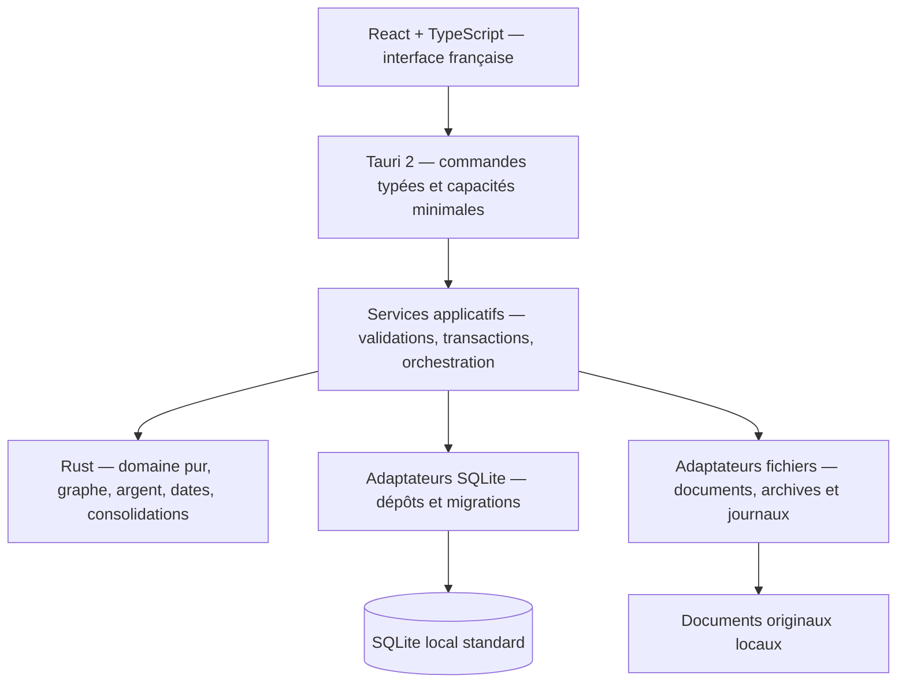

# Phase 1 — analyse et architecture

Date : 4 novembre 2026. Périmètre : conception, sans implémentation applicative.

## 1. Analyse du besoin

Le produit est un centre de pilotage du patrimoine familial : il décrit des droits, des biens, des engagements et leur évolution. Il ne remplace ni comptabilité générale, ni conseil fiscal, ni banque. Les quatre pays initiaux sont FR, TN, CH, AE ; Dubaï est une ville de AE. Le référentiel reste extensible. La consolidation est toujours en EUR ; la devise préférée d’une personne ne change pas les calculs consolidés.

Le même bien peut avoir plusieurs propriétaires, dont des tiers, et les sociétés peuvent former plusieurs niveaux de détention. La difficulté principale est donc la justesse du graphe de détention et des positions économiques, avant les écrans. Une vue membre est une projection de la base commune, pas une base séparée ni une restriction de confidentialité.

### Ordre de réalisation et critères de qualité

| Besoin | Conséquence de conception | Preuve attendue avant livraison |
|---|---|---|
| Intégrité | Contraintes SQLite, validations Rust, transactions, révisions conservées | Échec atomique des écritures invalides et récupération après interruption |
| Indépendance | SQLite standard, fichiers originaux, CSV documentés, XLSX lisible | Récupération avec outils libres sans l’application |
| Consolidation | Moteur déterministe séparé des écrans, graphe acyclique daté | Résultats chiffrés pour chemins multiples, tiers et prêts internes |
| Historique | Dates d’effet et de connaissance distinctes | Reconstitution avant/après correction et taux historiques |
| Usage local | Un seul processus desktop, aucune requête réseau nécessaire | Démarrage et scénario métier réseau coupé |
| Pérennité | Modules métiers, migrations versionnées, dépendances limitées | Tests d’upgrade/restauration des versions supportées |
| Ergonomie | Libellés français, même contexte membre/date pour toutes les vues | Parcours clavier, états vides et erreurs de saisie exploitables |

### Utilisateur et parcours

Un administrateur local gère une base familiale. Premier parcours : créer les personnes et les sociétés, définir le périmètre familial daté, saisir les participations et propriétés, puis les actifs, dettes et valeurs, saisir les taux manquants et vérifier les alertes. Le sélecteur global contient le contexte familial ou individuel et la date de référence. Toute liste, export de rapport et visualisation reçoit explicitement ce contexte.

Les modules opérationnels suivent : immobilier et loyers ; banques, caisses et dettes ; métaux et indicateurs de sociétés ; documents ; rapports. La section « Sauvegarde et export » est principale dès le socle. Un export complet de portabilité contient toujours toute la base, indépendamment du filtre visuel ; un rapport filtré indique son périmètre et ne se présente jamais comme une sauvegarde.

## 2. Architecture technique proposée



### Responsabilités et dépendances

- **React/TypeScript** : présentation, formulaires, navigation, états de requête, accessibilité. Les montants transitent en chaînes décimales et les droits en couples d’entiers textuels numérateur/dénominateur, jamais en nombres JS pour les calculs. Un graphique peut convertir une valeur finale en nombre pour sa géométrie ; son infobulle affiche le montant exact renvoyé par Rust. Aucune règle financière ni requête SQL dans un composant.
- **Frontière Tauri** : commandes explicitement autorisées, DTO versionnés, limites de taille et erreurs structurées traduites en français. Aucune commande générique de SQL, shell ou lecture arbitraire d’un chemin. Les dialogues sélectionnent les fichiers autorisés ; les chemins sont validés côté Rust. En production, aucune origine distante ni script distant ; CSP stricte, ressources embarquées, télémétrie absente.
- **Services applicatifs Rust** : un cas d’usage par commande, validation des droits/pourcentages/dates, unité de travail transactionnelle, audit dans la même transaction. Les lectures obtiennent un instantané cohérent. Les exports, imports et restaurations sont des opérations longues avec progression et annulation aux points sûrs.
- **Domaine Rust pur** : valeurs décimales/rationnelles exactes, dates métier, graphe daté, moteur de positions et règles de qualité. Il ne dépend ni de Tauri ni de SQLite et peut être testé sans environnement graphique.
- **Infrastructure** : `rusqlite` et API de sauvegarde SQLite, migrations SQL embarquées, import/export, intégrité des fichiers. Choix d’un accès synchrone SQLite sur un travailleur dédié pour ne pas bloquer l’interface ; un ordonnanceur sérialise les mutations et permet une barrière de sauvegarde. Les tâches graphiques ne conservent pas de transaction ouverte.

### Bibliothèques proposées et limites

| Fonction | Choix proposé | Justification / validation prévue |
|---|---|---|
| Application desktop | Tauri 2, plugins officiels de dialogue et ouverture contrôlée | Surface IPC réduite ; compatibilité Linux à vérifier en phase 2 |
| Interface | React + TypeScript strict, Vite | Construction locale reproductible ; aucun CDN |
| Navigation / UI | React Router, composants locaux composés avec Radix UI | Comportements clavier/accessibilité ; design sobre français |
| Graphiques | Recharts | Axes et interactions ; uniquement résultats métier validés en phase 9 |
| SQLite | rusqlite, SQLite embarqué | Version contrôlée, transactions, contraintes et Online Backup API |
| Précision | num-bigint / num-rational, parseur décimal contrôlé | Produits et inversions exacts, aucune troncation intermédiaire |
| Sérialisation / identifiants | serde, UUID v4, time | Chaînes exactes, identités stables, dates locales et UTC distinctes |
| Fichiers | sha2, zip, csv, rust_xlsxwriter | Formats ouverts, sommes SHA-256, cellules XLSX explicitement typées |
| Tests | cargo test, tests d’intégration SQLite, Vitest/Testing Library ; E2E Tauri Linux | Priorité métier et récupération ; compatibilité du pilote WebKit à établir au socle |

Ces choix ne constituent pas des dépendances déjà installées ou compilées. Au socle, vérifier versions stables compatibles Tauri 2, licences, maintenance, MSRV Rust et distribution Linux cible. Épingler les versions résolues dans `Cargo.lock` et `package-lock.json`, la toolchain Rust dans `rust-toolchain.toml` et une version Node LTS précise. Pas de numéros de patch inventés dans la conception. Les bibliothèques d’archives ne dispensent pas de valider les chemins et limites d’extraction.

### Déploiement Linux

Construire d’abord une AppImage x86_64 sur la plus ancienne distribution Linux officiellement supportée et documentée ; proposer le `.deb` ensuite. Architecture ARM64 et autres environnements de bureau : cibles ultérieures explicites. Phase 2 : vérifier prérequis WebKitGTK 4.1, GTK, outils de compilation, intégration des dialogues et chemins XDG. Phase 10 : valider AppImage, bibliothèques embarquées, lancement sans installation, éventuelle absence de FUSE et alternative d’extraction documentée.

Il n’y a pas de serveur applicatif HTTP en production ; le serveur Vite ne sert qu’au développement. Le WebView n’accède pas directement à SQLite. L’application reste exécutable réseau coupé. Les mises à jour sont des paquets installés manuellement en V1, sans updater réseau obligatoire. Aucune base n’est rangée dans l’AppImage ou le checkout.

## 3. Organisation du dépôt cible

Cette arborescence est une **cible des prochaines phases**. Seuls README et les documents de phase 1 sont créés maintenant.

```text
patrimoine/
├── README.md
├── docs/
│   ├── cahier-des-charges.md
│   ├── 01-architecture.md … 05-validation-et-plan.md
│   ├── decisions.md
│   └── avancement.md
├── package.json / package-lock.json / tsconfig.json / vite.config.ts
├── src/
│   ├── app/                 # routeur, contexte membre/date et coque
│   ├── components/          # formulaires, tables, erreurs et composants accessibles
│   ├── features/            # family, ownership, property, rentals, treasury,
│   │                       # debt, metals, companies, documents, portability
│   ├── services/            # adaptateur invoke, DTO, état des appels
│   └── styles/              # thème local et tokens
├── crates/
│   ├── domain/src/          # money, fx, temporal, ownership, positions, consolidation
│   ├── application/src/     # cas d’usage et interfaces des dépôts
│   └── infrastructure/
│       ├── src/             # sqlite, documents, backup, csv, xlsx
│       └── migrations/      # SQL numérotés, checksum et registre
├── src-tauri/
│   ├── Cargo.toml / tauri.conf.json / capabilities/
│   └── src/                 # amorçage, état applicatif, commandes fines
├── tests/
│   ├── fixtures/            # jeux synthétiques explicitement étiquetés
│   ├── integration/         # migrations, cas métier, portabilité
│   └── e2e/                 # scénarios desktop français hors ligne
├── scripts/                 # vérification, construction, inspection indépendante
└── .github/workflows/       # tests, lint, compilation Linux et paquets
```

Les crates domaine/application/infrastructure ne connaissent pas le framework d’interface. Le bootstrap Tauri assemble leurs implémentations ; les tests du domaine restent rapides. Les dépôts portent le SQL. Les fixtures ne sont jamais injectées silencieusement dans une base utilisateur.

## 4. Contrat des commandes et des résultats

Les commandes futures suivent des cas d’usage, par exemple `create_person`, `replace_ownership_interval`, `record_exchange_rate`, `record_transaction`, `consolidate`, `prepare_backup`, `inspect_restore`, `activate_restore`. Les noms illustrent les frontières et ne sont pas des API implémentées.

Une écriture reçoit des identifiants stables, une date d’effet et le numéro de révision attendu. Un conflit de révision annule l’opération et demande un rechargement, au lieu d’écraser une saisie. Toute requête patrimoniale reçoit `{context, effective_date, knowledge_cutoff?, filters}`. La borne de connaissance se résout en séquence de commit monotone, conservée avec le rapport : un horodatage seul ne distingue pas deux commits simultanés et peut reculer avec l’horloge. Le contexte, les versions de schéma et d’algorithme accompagnent les résultats et rapports.

Un résultat de consolidation contient : lignes sourcées (actif/dette/contrat), entités traversées, chemins ou contribution agrégée, quote-part, montant et devise d’origine, taux/date/source, montant EUR, éliminations, périmètre couvert et anomalies. Les agrégats exposent `complet`, `partiel` ou `non_calculable` et les causes, jamais seulement un nombre optionnel transformé en zéro. Les valeurs négatives sont permises quand leur sens est réel ; un patrimoine net peut être négatif.

Une erreur contient un code stable, un message français, les objets concernés et une action possible ; aucune donnée patrimoniale détaillée n’est copiée automatiquement dans un journal d’erreurs. Les journaux techniques sont locaux, bornés et distincts de l’audit durable. L’administrateur est autorisé à lire tous les objets ; les vues individuelles n’offrent aucune isolation de sécurité.

## 5. Hypothèses explicites et questions

Hypothèses non bloquantes pour la conception :

1. Une base familiale, un administrateur local, une seule instance écrivaine ; verrou de processus et transactions même si une deuxième fenêtre est ouverte. Pas de synchronisation de répertoires SQLite actifs.
2. Droits économiques proportionnels fixes par intervalle, distincts du titre juridique et des votes. Les pourcentages connus partiels restent incomplets. Pas de déduction automatique d’un droit économique manquant.
3. Pas de cycles, actions préférentielles avec cascade de distribution, usufruit/nue-propriété, options ou participations négatives calculés automatiquement en V1. Ces situations doivent être signalées comme non prises en charge, sans les assimiler à une pleine propriété. Extensions futures des droits possibles.
4. Valorisation avant frais et fiscalité de cession ; pas de fiscalité automatique, de connexion bancaire, de récupération de cotations ni de performance financière calculée à partir d’une simple variation de stock.
5. Les valeurs globales de sociétés sont des **valeurs nettes des capitaux propres**, à date et périmètre explicites ; leur actif économique apparaît comme participation opaque. Une valeur d’entreprise doit être transformée/documentée avant son utilisation. Une couverture ambiguë bloque la consolidation concernée.
6. Les remboursements séparent principal/intérêts/frais. Les soldes et loyers ne créent pas deux fois un mouvement de trésorerie. Les garanties restent des engagements hors total tant qu’elles ne deviennent pas une dette.
7. Historique par dates civiles, intervalles `[début, fin)` ; instants de saisie en UTC. Les flux ont une date économique et une date d’enregistrement ; les corrections ne suppriment pas les versions précédentes.
8. Pas de chiffrement spécifique V1 ; la protection au repos s’appuie sur le compte Linux, les permissions et éventuellement le chiffrement du disque choisi par l’utilisateur. Les sauvegardes non chiffrées doivent être stockées sur un support protégé.

Aucune réponse supplémentaire n’est nécessaire pour terminer la phase 1. Avant l’usage réel, confirmer les formes juridiques réellement rencontrées (notamment démembrement/droits non proportionnels), les méthodes de valorisation opaques et le traitement de leurs prêts liés. Avant la construction de livraison, choisir la distribution Linux minimale et les architectures matérielles. Ces décisions conditionnent les fonctionnalités et paquets correspondants, pas la rédaction du présent dossier.
