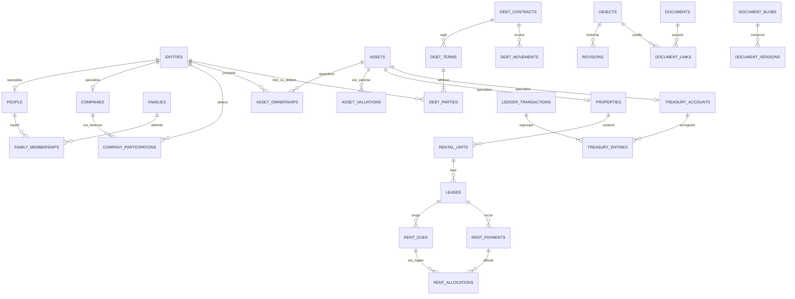

# Modèle relationnel SQLite proposé

Statut : conception de phase 1, non implémentée. Aucun DDL ni aucune migration n'est exécuté dans cette phase. Les noms ci-dessous constituent le catalogue de référence à traduire en migrations lors des phases suivantes.

Mise à jour de lecture : ce catalogue reste le modèle cible complet. Le socle et le registre de phase 3 sont désormais implémentés par les migrations `0001`/`0002`, avec certains regroupements explicités dans [les décisions](decisions-architecture.md). Voir [l’avancement](../projet/avancement.md) pour distinguer les tables réellement livrées des modules futurs.

## Conventions communes

| Notation | Représentation SQLite et règle |
| --- | --- |
| `Id` | `TEXT`, UUID stable généré localement, jamais réutilisé. |
| `Dec` | `TEXT`, décimal canonique signé : point décimal, sans séparateur de milliers ni exposant, zéro normalisé. Validation et calcul exacts dans Rust ; jamais `REAL`, `SUM(CAST(... AS REAL))` ni conversion en `number` JavaScript. |
| `Ratio` | Paire de colonnes `TEXT` `<nom>_num` / `<nom>_den`, entiers canoniques, numérateur ≥ 0, dénominateur > 0, fraction réduite par PGCD, chacun limité à 36 chiffres en V1. Pour un droit : numérateur ≤ dénominateur. Les deux colonnes sont `NULL` ensemble si inconnu. Accepte exactement un tiers ou un pourcentage décimal, sans inventer `33.3333 %`. |
| `Date` | `TEXT`, jour ISO `YYYY-MM-DD` validé dans Rust. |
| `Instant` | `TEXT`, UTC ISO 8601 normalisé ; même précision pour tous les enregistrements. |
| `Code` | `TEXT`, FK vers le référentiel indiqué, ou enum fermé par `CHECK` lorsqu'indiqué. |
| `Bool` | `INTEGER`, `CHECK IN (0,1)`. |
| `?` | Champ nullable ; tous les autres champs sont obligatoires. Une valeur inconnue demeure `NULL`, sans substitution par zéro. |

Tables `STRICT`, SQLite avec clés étrangères activées à chaque connexion. Les montants, taux, ratios et quantités sont validés avant écriture et de nouveau lors des imports. Une somme n'est pas arrondie pour satisfaire une contrainte de propriété. La précision, les arrondis et les unités sont définis dans [les règles métier](regles-metier.md).

Les valeurs monétaires portent une devise explicite, généralement au niveau de l'objet parent lorsque celle-ci est unique et immuable. Un montant sans devise n'est pas accepté. La devise d'un compte ayant des mouvements ne se modifie pas : créer un nouveau compte. Les droits sont des fractions `Ratio` entre `0` et `1`, distinctes des pourcentages affichés ; la notation compacte du catalogue désigne toujours deux colonnes SQL, jamais un type SQLite propriétaire. Les valeurs monétaires, cotations, poids et puretés restent des `Dec`.

## Identité, versions et temps

La conception sépare **identité stable**, **état économique daté** et **date d'enregistrement**. Toutes les versions et annulations sont exportables. L'archivage d'une fiche n'efface ni ses droits ni ses flux historiques.

| Table | Colonnes essentielles et relations |
| --- | --- |
| `objects` | `id Id PK`, `kind Code`, `created_at Instant`. Registre des objets documentables : entité, actif, participation, bail, paiement, dette, opération, document, etc. Les tables spécialisées utilisent ce même identifiant en PK/FK. Le type est immuable. |
| `change_sets` | `id Id PK`, `sequence INTEGER UNIQUE` monotone, `recorded_at Instant`, `reason TEXT`, `actor_label TEXT?`, `command_id Id UNIQUE`. Une commande métier atomique ; clé d'idempotence contre un double clic ou une reprise. |
| `revisions` | `id Id PK`, `object_id Id FK objects`, `change_set_id Id FK change_sets`, `recorded_at Instant`, `supersedes_revision_id Id? FK revisions`, `is_void Bool`, `reason TEXT?`. Révision immuable d'un fait ou segment d'état. |
| `audit_events` | `id Id PK`, `change_set_id FK change_sets`, `object_id FK objects`, `revision_id FK revisions`, `action Code`, `summary TEXT`. Résumé des changements importants, sans copie supplémentaire des documents ni secrets. |

Dans les tables ci-dessous, **V** signifie `revision_id Id PK/FK revisions`. L'identité stable de l'objet est `revisions.object_id`. Une révision appartient à exactement une table spécialisée correspondant au type d'objet ; le service d'écriture et les triggers d'intégrité vérifient cette correspondance.

**État temporel** : `V + valid_from Date + valid_to Date?`, intervalle `[valid_from, valid_to)`. `valid_to NULL` signifie fin ouverte. **Fait ponctuel** : `V + effective_on Date`. Les deux sont distingués dans le catalogue. Pour les relations, chaque attribution ou segment possède son propre `objects.id`, permettant une correction sans changer les références externes.

Une correction ajoute une révision remplaçant la version antérieure, avec même objet et motif. Les anciennes versions ne sont jamais réécrites. Une annulation est une révision `is_void=1` ; la ligne typée est conservée mais n'est pas active. Les remplacements ne peuvent former ni branche ni cycle. Un changement futur d'état ajoute un segment : si nécessaire, la fermeture du segment précédent est représentée par sa révision de remplacement, dans le même `change_set`.

Pour calculer à la date économique `D` avec une connaissance bornée, la borne autoritative est le numéro séquentiel de `change_set` : ne retenir que les révisions de séquence au plus égale à cette borne, qui n'ont pas de remplacement enregistré avant cette même borne, non annulées, applicables à `D`. L'instant `K` enregistré dans un rapport est descriptif ; il ne se combine pas avec un filtre contradictoire sur l'horloge système. La séquence distingue deux commits au même instant et reste fiable si l'horloge recule. Un filtre utilisateur par heure est résolu en une séquence puis figé ; un recul d'horloge est signalé. Dans les états courants de connaissance, les segments d'un même état ne se chevauchent pas. Le mode habituel utilise le dernier commit connu, donc les corrections rétroactives connues ; un rapport exporté enregistre `D`, `K`, la séquence et la version du moteur.

`revision_id` est une référence historique ; les FK métier ordinaires pointent vers l'identité stable. Lorsqu'une commande doit justifier une source exacte de calcul, elle référence aussi sa révision. Les suppressions physiques d'objets référencés sont interdites (`ON DELETE RESTRICT`). Les lignes enfants de versions sont immuables et supprimables uniquement avec une base temporaire rejetée, jamais lors d'une correction métier.

## 1. Référentiels et paramètres

| Table | Colonnes essentielles et contraintes |
| --- | --- |
| `countries` | `code TEXT PK` ISO 3166-1 alpha-2, `name_fr TEXT`. FR, TN, CH, AE au départ ; ajout possible. Dubaï est une ville sous AE. |
| `currencies` | `code TEXT PK` ISO 4217, `name_fr TEXT`, `minor_unit INTEGER CHECK 0..6`, `active Bool`. EUR, TND, CHF, AED, USD ; TND à 3 décimales, EUR/CHF/AED/USD à 2. |
| `asset_categories` | `code TEXT PK`, `name_fr TEXT`, `parent_code? FK asset_categories`. Codes métier stables, sous-catégories extensibles sans modification des propriétaires. |
| `app_settings` | `key TEXT PK`, `value_text TEXT`, `value_type Code`, `updated_at Instant`. Préférences non secrètes ; les politiques qui influent sur les calculs utilisent des versions datées, pas une préférence écrasable. |
| `schema_migrations` | `version INTEGER PK`, `name TEXT`, `checksum TEXT`, `applied_at Instant`, `application_version TEXT`. Version du schéma également exposée dans les manifestes. |

Les référentiels utilisés ne sont pas supprimés. Une désactivation interdit seulement les nouvelles saisies. Une mise à jour du libellé n'altère pas les codes ni les valeurs historiques.

## 2. Personnes, famille et entités juridiques

| Table | Colonnes essentielles et contraintes |
| --- | --- |
| `entities` | `id Id PK/FK objects`, `entity_kind Code` (`person`, `company`, `other_legal_entity`). Supertype commun de tous propriétaires, débiteurs et créanciers. |
| `people` | `entity_id Id PK/FK entities`. Identité d'une personne physique, membre ou extérieure ; pas de table par membre. |
| `companies` | `entity_id Id PK/FK entities`, `legal_form TEXT?`, `registration_reference TEXT?`. La forme juridique ne détermine pas la méthode de consolidation. |
| `entity_profiles` | État temporel **V**, `entity_id FK entities`, `display_name TEXT`, `first_name TEXT?`, `last_name TEXT?`, `birth_date Date?`, `residence_country? FK countries`, `domicile_country? FK countries`, `preferred_currency FK currencies`, `activity TEXT?`, `notes TEXT`, `archived Bool`. Prénom/nom pour les personnes, raison sociale et domicile pour les sociétés. |
| `families` | `id Id PK/FK objects`, `name TEXT`. Une seule famille créée en V1 ; pas de limite artificielle au nombre de membres. |
| `family_memberships` | État temporel **V**, `family_id FK families`, `person_id FK people`, `relationship_label TEXT?`, `notes TEXT`. L'appartenance économique dépend de cet intervalle, jamais de `archived`. Pas de chevauchement actif pour une même personne dans la même famille. |

Une personne peut être locataire et membre ou associé extérieur avec la même identité. Les informations de contact non nécessaires au patrimoine restent facultatives. Les contraintes imposent un sous-type conforme à `entity_kind` et un seul profil actif par entité à une date donnée.

## 3. Participations et propriétés

| Table | Colonnes essentielles et contraintes |
| --- | --- |
| `company_participations` | État temporel **V**, `owner_entity_id FK entities`, `company_id FK companies`, `legal_share Ratio?`, `economic_share Ratio?`, `voting_share Ratio?`, `rights_label TEXT?`, `operation_id? FK patrimonial_operations`, `notes TEXT`. Propriétaire identifié obligatoire ; pas d'auto-participation. Un droit manquant reste inconnu. |
| `company_policies` | État temporel **V**, `company_id FK companies`, `mode Code` (`detailed`, `global_equity`), `coverage_status Code` (`complete`, `incomplete`, `unknown`), `coverage_notes TEXT`, `source_document_id? FK documents`. Un seul mode actif par société. |
| `company_valuations` | Fait ponctuel **V**, `company_id FK companies`, `equity_value Dec`, `currency FK currencies`, `source TEXT`, `method TEXT`, `coverage_notes TEXT`. Valeur des capitaux propres pour 100 % de l'entité, pas valeur d'entreprise avant dette ; dette interne déjà incluse, hypothèse déclarée. |
| `company_valuation_coverage` | `valuation_revision_id FK company_valuations`, `covered_object_id FK objects`, `coverage_kind Code` (`included`, `excluded`, `unknown`), `notes TEXT`, PK des deux références. Justifie les actifs, participations et dettes couverts par une valeur globale ; aucune addition automatique de lignes exclues. |
| `asset_ownerships` | État temporel **V**, `asset_id FK assets`, `owner_entity_id FK entities`, `legal_share Ratio?`, `economic_share Ratio?`, `rights_label TEXT?`, `operation_id? FK patrimonial_operations`, `notes TEXT`. Propriétaire identifié obligatoire. Droits économiques séparés des titres juridiques ; pas de champ libre « propriétaire ». |
| `ownership_declarations` | État temporel **V**, `target_object_id FK objects`, `rights_kind Code` (`legal`, `economic`, `voting`), `coverage_status Code` (`complete`, `partial`, `unknown`), `notes TEXT`. Cible exclusivement actif ou société, contrôlée par type. Permet de distinguer un reliquat extérieur connu d'un droit réellement manquant. |

Les parts d'une société ne créent pas un second actif générique : l'objet `company` et ses participations suffisent. Les valorisations globales ne sont jamais ajoutées aux actifs sous-jacents parcourus en mode détaillé. Un changement de mode est daté et audité.

Pour chaque intervalle élémentaire résultant de toutes les bornes de validité, vérifier séparément les droits juridiques, économiques et de vote. Sommes connues au plus égales à 1 ; un ensemble déclaré complet doit totaliser exactement 1 et ne contenir aucune valeur inconnue. Les droits de vote non applicables peuvent rester absents. Un résidu de titulaires non identifiés est signalé par `ownership_declarations` comme incomplet, sans créer une personne fictive ni un propriétaire nullable. La V1 stocke uniquement des contributions proportionnelles déjà agrégées et normalisées par détenteur ; elle ne modélise pas séparément les classes de parts. Les démembrements, options et droits préférentiels exigeant des formules non proportionnelles demeurent « non pris en charge » et empêchent une consolidation présentée comme complète.

Un ajout ou une correction de participation vérifie l'absence de cycle sur tous les segments de dates concernés, y compris les effets rétroactifs. Détenir une dette ou garantir une société ne crée pas une arête du graphe de propriété.

## 4. Actifs et immobilier

| Table | Colonnes essentielles et contraintes |
| --- | --- |
| `assets` | `id Id PK/FK objects`, `asset_kind Code` (`real_estate`, `bank_account`, `cash_box`, `metal_lot`, `other`). Une seule spécialisation conforme au type. |
| `asset_profiles` | État temporel **V**, `asset_id FK assets`, `name TEXT`, `category_code FK asset_categories`, `country FK countries`, `city TEXT?`, `notes TEXT`, `archived Bool`. |
| `asset_lifecycle_events` | Fait ponctuel **V**, `asset_id FK assets`, `event_kind Code` (`acquisition`, `disposal`, `opening_tracking`, `correction`), `quantity Dec?`, `consideration Dec?`, `fees Dec?`, `currency? FK currencies`, `operation_id? FK patrimonial_operations`, `notes TEXT`. Fait de cycle de vie ; le flux financier est enregistré une seule fois dans le journal de trésorerie. |
| `asset_valuations` | Fait ponctuel **V**, `asset_id FK assets`, `amount Dec`, `currency FK currencies`, `method TEXT`, `source TEXT`, `notes TEXT`. Réservé aux catégories valorisées par estimation ; les comptes et métaux utilisent leurs sources propres. |
| `properties` | `asset_id Id PK/FK assets`, `property_type Code` (appartement, maison, immeuble, terrain, commerce, bureau, garage, autre). |
| `property_details` | État temporel **V**, `property_id FK properties`, `address TEXT`, `surface_m2 Dec?`, `status Code` (`owner_occupied`, `rented`, `vacant`, `renovation`, `for_sale`, `sold`). Le statut vendu ne détruit pas les estimations, titres ou contrats. |
| `rental_units` | `id Id PK/FK objects`, `property_id FK properties`, `unit_reference TEXT`, UNIQUE `(property_id, unit_reference)`. Unité technique de location, jamais second actif consolidable. |
| `rental_unit_details` | État temporel **V**, `unit_id FK rental_units`, `name TEXT`, `surface_m2 Dec?`, `available_for_rent Bool`, `notes TEXT`. Un bien simple utilise une unité couvrant l'ensemble du bien. |

Le prix de revient provient des événements d'acquisition et de leurs frais ; il n'est pas recopié dans chaque estimation. Une cession partielle réduit les droits ou quantités via une opération atomique, sans supprimer l'identité ni les versions antérieures. Les estimations saisies après cession restent visibles dans l'historique mais ne réactivent pas un actif cédé.

## 5. Locations, échéances, paiements et dépenses

| Table | Colonnes essentielles et contraintes |
| --- | --- |
| `tenants` | `entity_id Id PK/FK entities`, `contact_notes TEXT`. Peut concerner personne ou société. |
| `leases` | `id Id PK/FK objects`, `unit_id FK rental_units`. Le bail ne change pas d'unité ; créer un nouveau contrat si changement réel. |
| `lease_tenants` | État temporel **V**, `lease_id FK leases`, `tenant_entity_id FK tenants`, `role Code`. Plusieurs cotitulaires possibles. |
| `lease_terms` | État temporel **V**, `lease_id FK leases`, `currency FK currencies`, `rent Dec`, `recoverable_charges Dec`, `frequency Code`, `due_day INTEGER?`, `deposit_required Dec`, `revision_rule TEXT?`, `notes TEXT`. Révision de loyer par nouveau segment ; valeurs historiques conservées. |
| `rent_dues` | Fait ponctuel **V** avec `effective_on = échéance`, `lease_id FK leases`, `terms_revision_id FK lease_terms`, `period_start Date`, `period_end Date`, `rent_due Dec`, `charges_due Dec`, `currency FK currencies`, `due_kind Code` (`normal`, `adjustment`). Échéance générée ou rectificative, pas solde écrasable. |
| `rent_due_keys` | `due_id Id PK/FK objects` typé échéance locative, `generation_key TEXT UNIQUE`. Identité idempotente de l'échéance générée ; portée par l'identité stable pour ne pas empêcher ses corrections versionnées. |
| `rent_receivable_rights` | État temporel **V**, `due_id FK objects` typé échéance locative, `creditor_entity_id FK entities`, `economic_share Ratio`, `source_ownership_revision_id? FK asset_ownerships`, `assignment_operation_id? FK patrimonial_operations`, `notes TEXT`. Droits sur la créance nés avec le revenu couru ; total à 1 si complet, cession ultérieure datée. |
| `rent_receivable_adjustments` | Fait ponctuel **V**, `due_id FK objects` typé échéance locative, `creditor_entity_id FK entities`, `valuation_delta Dec` signé, `kind Code` (`impairment`, `reversal`), `source TEXT`, `source_document_id? FK documents`, `reason TEXT`. Dépréciation négative ou reprise positive, séparée des encaissements et sans effacer la créance nominale. |
| `rent_payments` | Fait ponctuel **V**, `lease_id FK leases`, `payment_kind Code` (`receipt`, `refund`), `refunded_payment_id? FK objects` typé paiement, `amount Dec`, `currency FK currencies`, `payer_entity_id? FK entities`, `payment_reference TEXT`, `treasury_entry_revision_id?`, `treasury_entry_line_id?`, `unlinked_reason TEXT?`. Référence composite FK à une entrée de trésorerie précise ; absence possible avec alerte tant que non rapproché. Un remboursement est négatif et référence le paiement d'origine. |
| `rent_allocations` | Fait ponctuel **V**, `payment_id FK rent_payments via objects`, `due_id FK rent_dues via objects`, `component Code` (`rent`, `charges`), `amount Dec`, `currency FK currencies`. Relation plusieurs-à-plusieurs ; somme allouée au plus égale à chaque paiement et à chaque composant d'échéance, sauf régularisation explicite. |
| `rental_expenses` | Fait ponctuel **V**, `property_id FK properties`, `unit_id? FK rental_units`, `lease_id? FK leases`, `category Code` (`operating`, `works`, `tax`, `other`), `amount Dec`, `currency FK currencies`, `recoverable Bool`, `treasury_entry_revision_id?`, `treasury_entry_line_id?`, `notes TEXT`. Les liens optionnels doivent appartenir au même bien. |
| `deposit_movements` | Fait ponctuel **V**, `lease_id FK leases`, `kind Code` (`received`, `returned`, `applied_to_due`, `adjustment`), `amount Dec`, `currency FK currencies`, `rent_due_id? FK objects`, `treasury_entry_revision_id?`, `treasury_entry_line_id?`, `reason TEXT`. Dette envers le locataire calculée par mouvements ; ce n'est pas un loyer avant affectation explicite. |

Échéances et paiements ne deviennent pas un actif financier supplémentaire à leur montant intégral : seul le reliquat exigible impayé est une créance dérivée, selon la politique métier. Les droits sur cette créance sont ceux du bailleur au moment où elle naît ; une vente du bien ne la transfère pas sans cession explicite. La référence aux droits sources permet de contrôler une correction rétroactive ; une divergence déclenche un recalcul ou une régularisation tracée, jamais un changement silencieux de créancier. Dépôt reçu : l'augmentation de trésorerie et l'obligation de restitution sont deux effets du même mouvement, jamais un contrat de dette manuel dupliqué. Une affectation de dépôt diminue l'obligation et règle l'échéance, sans nouveau crédit bancaire.

Une dépréciation locative est limitée au reliquat du créancier concerné. Si un paiement, une cession ou une correction rend les dépréciations actives incompatibles avec le nouveau reliquat, demander une reprise/régularisation traçable ; ne pas masquer le problème en bornant silencieusement un chiffre. La valeur financière nette ne peut être négative ni dépasser la créance nominale restante sans justificatif d'un autre droit.

Un remboursement de trop-perçu est un paiement négatif explicitement typé, relié au paiement d'origine ; les allocations de correction sont révisées atomiquement. Les paiements ne changent pas silencieusement la devise du bail. Une conversion de règlement porte ses deux montants et son lien à l'opération de change, plutôt qu'un taux implicite.

## 6. Trésorerie, transferts et rapprochements

| Table | Colonnes essentielles et contraintes |
| --- | --- |
| `treasury_accounts` | `asset_id Id PK/FK assets`, `account_kind Code` (`bank`, `cash`), `currency FK currencies`, `tracking_start Date`. Les copropriétaires sont dans `asset_ownerships`. |
| `bank_accounts` | `asset_id Id PK/FK treasury_accounts`, `bank_name TEXT`, `account_reference TEXT?`, `country FK countries`. Pas de connexion bancaire V1. |
| `cash_boxes` | `asset_id Id PK/FK treasury_accounts`, `storage_location TEXT`, `country FK countries`. Espèces physiques séparées de la banque. |
| `ledger_transactions` | Fait ponctuel **V**, `kind Code` (`opening`, `receipt`, `payment`, `transfer`, `fx`, `rent`, `loan`, `asset_trade`, `dividend`, `correction`), `label TEXT`, `operation_id? FK patrimonial_operations`, `external_reference TEXT?`, `reversal_of_id? FK objects`. Unité atomique des lignes de trésorerie. |
| `treasury_entries` | `transaction_revision_id FK ledger_transactions`, `line_id Id`, `account_id FK treasury_accounts`, `amount Dec` signé, `role Code` (`principal`, `fee`, `opening`, `adjustment`), PK `(transaction_revision_id,line_id)`. Devise héritée du compte ; aucune somme entre devises différentes. |
| `fx_transaction_details` | `transaction_revision_id PK/FK ledger_transactions`, `debit_line_id Id`, `credit_line_id Id`, `debited_amount Dec`, `credited_amount Dec`, `fee_amount Dec`, `fee_currency FK currencies`, `source TEXT`. Deux FK composites vers les lignes de cette même transaction ; cohérence de leurs signes et montants contrôlée. Le taux effectif est le quotient rationnel exact des deux montants, calculé à la demande ; aucun taux dérivé tronqué n'est stocké comme source. |
| `account_reconciliations` | Fait ponctuel **V**, `account_id FK treasury_accounts`, `statement_balance Dec`, `statement_document_id? FK documents`, `notes TEXT`. Écart calculé contre le journal à la date ; une différence n'est pas corrigée automatiquement. |
| `patrimonial_operations` | Fait ponctuel **V**, `kind Code` (`gift`, `cash_transfer`, `asset_sale`, `share_sale`, `metal_transfer`, `loan`, `repayment`, `capital_contribution`, `other`), `from_entity_id FK entities`, `to_entity_id FK entities`, `asset_id? FK assets`, `company_id? FK companies`, `quantity Dec?`, `declared_value Dec?`, `currency? FK currencies`, `notes TEXT`. Regroupe les effets juridiques et financiers ; n'ajoute pas une valeur patrimoniale. |

Le solde d'ouverture est une transaction `opening` unique au début du suivi, pas un champ de solde en parallèle. Solde à `D` = ouverture + lignes signées jusqu'à `D`. L'absence d'ouverture confirmée rend le solde incomplet. Une correction exige un motif et une écriture explicite ou une révision traçable.

Un transfert de même devise possède deux jambes opposées hors frais ; une conversion possède deux jambes en devises distinctes, avec frais séparés. Une entrée/sortie vers l'extérieur du suivi peut n'avoir qu'une jambe, avec contrepartie documentée dans l'opération. Il ne s'agit pas d'une comptabilité générale à plan de comptes. Un loyer ou remboursement lié à une ligne de trésorerie décrit la nature de cette ligne ; il ne crée pas une seconde ligne implicite.

## 7. Devises et métaux

| Table | Colonnes essentielles et contraintes |
| --- | --- |
| `exchange_rates` | Fait ponctuel **V**, `base_currency FK currencies`, `quote_currency FK currencies`, `rate Dec > 0`, `source TEXT?`, `notes TEXT`. Convention : 1 unité de base vaut `rate` unités de cotation ; EUR privilégié en cotation. Base différente de cotation. Une valeur retenue par paire et date, les corrections étant des révisions. |
| `metal_lots` | `asset_id Id PK/FK assets`, `metal Code` (`gold`, `silver`), `form Code`, `original_weight_unit Code` (`g`, `kg`, `troy_oz`), `unit_gross_weight Dec > 0`, `purity Dec` dans `]0,1]`. Pureté et poids propres au lot ; changement par scission documentée. |
| `metal_lot_movements` | Fait ponctuel **V**, `lot_id FK metal_lots`, `kind Code` (`opening`, `purchase`, `sale`, `split_in`, `split_out`, `inventory_correction`, `storage_transfer`), `quantity_change Dec`, `unit_cost Dec?`, `currency? FK currencies`, `location_from TEXT?`, `location_to TEXT?`, `operation_id? FK patrimonial_operations`, `reason TEXT`. Interdit de rendre la quantité négative à un point historique. |
| `metal_lot_locations` | État temporel **V**, `lot_id FK metal_lots`, `country FK countries`, `storage_location TEXT`. Si un lot est réparti physiquement, le scinder en lots enfants traçables, plutôt qu'un emplacement ambigu. |
| `metal_lot_lineage` | `parent_lot_id FK metal_lots`, `child_lot_id FK metal_lots`, `operation_id FK patrimonial_operations`, `quantity_transferred Dec`, PK des deux lots et opération. Conserve le coût et l'origine des ventes partielles et transferts. |
| `metal_quotes` | Fait ponctuel **V**, `metal Code`, `price Dec > 0`, `currency FK currencies`, `unit Code` (`g`, `kg`, `troy_oz`), `source TEXT?`, `notes TEXT`. Prix de métal fin ; pas poids brut. |
| `metal_premiums` | Fait ponctuel **V**, `lot_id FK metal_lots`, `premium_kind Code` (`amount_per_unit`, `fraction_of_intrinsic`), `value Dec`, `currency? FK currencies`, `notes TEXT`. Devise obligatoire seulement pour un montant ; pas de confusion entre prime unitaire et prime totale. |

Quantité restante et poids fin sont dérivés. `1 kg = 1000 g` et `1 once troy = 31.1034768 g` exactement. Les coûts de revient restants sont calculés au prorata du lot homogène, sans réévaluer le prix historique lors d'une vente partielle. Un transfert de propriété modifie `asset_ownerships` ; un mouvement interne de stockage ne modifie ni le poids ni la valeur consolidée.

## 8. Financements, créances et garanties

| Table | Colonnes essentielles et contraintes |
| --- | --- |
| `debt_contracts` | `id Id PK/FK objects`, `currency FK currencies`, `tracking_start Date`. Un contrat unique génère les vues créance et dette ; aucune duplication dans `assets`. |
| `debt_terms` | État temporel **V**, `debt_id FK debt_contracts`, `name TEXT`, `interest_rate Dec?`, `interest_convention TEXT?`, `credit_limit Dec?`, `principal_status Code` (`complete`, `unknown`), `notes TEXT`. Un plafond n'est pas un principal effectivement dû. |
| `debt_parties` | `terms_revision_id FK debt_terms`, `line_id Id`, `side Code` (`creditor`, `debtor`), `entity_id FK entities`, `legal_share Ratio?`, `economic_share Ratio?`, `liability_kind Code` (`several`, `joint_and_several`, `single`), `notes TEXT`, PK `(terms_revision_id,line_id)`. Totaux économiques par côté à 1 lorsqu'ils sont connus ; affectation de dette indépendante des titres de l'actif financé. |
| `debt_movements` | Fait ponctuel **V**, `debt_id FK debt_contracts`, `kind Code` (`opening`, `drawdown`, `principal_repayment`, `principal_adjustment`, `write_off`), `principal_change Dec` signé, `interest_paid Dec`, `fees_paid Dec`, `operation_id? FK patrimonial_operations`, `treasury_entry_revision_id?`, `treasury_entry_line_id?`, `reason TEXT`. Principal, intérêts, frais séparés ; devise héritée du contrat. `write_off` désigne exclusivement une remise ou extinction juridique documentée du principal sur les deux faces du contrat. |
| `debt_receivable_adjustments` | Fait ponctuel **V**, `debt_id FK debt_contracts`, `creditor_entity_id FK entities`, `valuation_delta Dec` signé, `kind Code` (`impairment`, `reversal`), `source TEXT`, `source_document_id? FK documents`, `reason TEXT`. Dépréciation de la seule créance du prêteur ou reprise ; devise héritée du contrat. N'altère ni le principal contractuel ni l'obligation du débiteur. |
| `debt_schedules` | Fait ponctuel **V**, `debt_id FK debt_contracts`, `due_on Date`, `expected_principal Dec`, `expected_interest Dec`, `expected_fees Dec`, `status Code` (`planned`, `cancelled`). Prévision ne diminuant jamais le principal réel. |
| `debt_payment_allocations` | Fait ponctuel **V**, `movement_id FK objects`, `schedule_id FK objects`, `principal Dec`, `interest Dec`, `fees Dec`. Lie les remboursements à une ou plusieurs échéances sans dupliquer les mouvements réels. |
| `debt_asset_links` | État temporel **V**, `debt_id FK debt_contracts`, `asset_id FK assets`, `relation_kind Code` (`finances`, `collateral`), `attributed_principal_share Ratio?`, `notes TEXT`. L'attribution au bien sert aux indicateurs du bien ; ni la sûreté ni cette attribution ne désignent le débiteur. |
| `debt_guarantees` | État temporel **V**, `debt_id FK debt_contracts`, `guarantor_entity_id FK entities`, `limit_amount Dec?`, `notes TEXT`. Engagement contingent, hors dette certaine ; appel de garantie par opération explicite créant/transférant l'obligation. |

Le capital restant est ouverture + tirages + ajustements − principal remboursé, les remises juridiques ayant un ajustement négatif justifié. Une dépréciation estimée par le prêteur ne constitue jamais une remise juridique : elle se saisit dans `debt_receivable_adjustments`, sans effacer la dette certaine. Sa valeur doit rester compatible avec le reliquat du créancier ; tout remboursement, correction ou transfert rendant la dépréciation incompatible demande une reprise tracée. Les éliminations n'annulent que la valeur appariée justifiée et exposent séparément les résidus. Un unique événement d'ouverture, sauf contrat créé à son origine où un tirage initial suffit. Une dette historique incomplète ne reçoit pas automatiquement un solde zéro. Un découvert bancaire demeure le solde négatif du compte : ne pas le saisir simultanément comme contrat de dette distinct sans mécanisme explicite de rapprochement et exclusion.

En présence de solidarité, distinguer exposition juridique maximale et allocation économique patrimoniale. Une allocation économique inconnue interdit un total individuel complet. Les parts économiques du créancier et du débiteur peuvent différer ; l'élimination intrafamiliale est calculée à partir de ces mêmes deux côtés et de la participation économique aux sociétés, pas à partir du collatéral.

## 9. Pilotage des sociétés

| Table | Colonnes essentielles et contraintes |
| --- | --- |
| `company_financial_periods` | **V**, `company_id FK companies`, `period_start Date`, `period_end Date`, `frequency Code` (`monthly`, `quarterly`, `annual`), `currency FK currencies`, `revenue Dec?`, `operating_expenses Dec?`, `operating_result Dec?`, `net_result Dec?`, `indicative_cash Dec?`, `indicative_debt Dec?`, `important_receivables Dec?`, `notes TEXT`. Période demi-ouverte, données de gestion ; aucune addition patrimoniale automatique. |
| `company_distributions` | Fait ponctuel **V**, `company_id FK companies`, `beneficiary_entity_id FK entities`, `amount Dec`, `currency FK currencies`, `distribution_kind Code` (`declared`, `paid`), `related_declaration_id? FK objects`, `operation_id? FK patrimonial_operations`, `treasury_entry_revision_id?`, `treasury_entry_line_id?`. Dividende déclaré distinct du paiement ; pas d'enrichissement automatique des actionnaires à partir du résultat net. |

Les périodes de gestion de fréquences différentes peuvent coexister mais ne sont jamais sommées ensemble. La trésorerie indicative n'est pas une deuxième version des comptes bancaires. En mode détaillé, les flux et obligations déclarés doivent être réconciliés avec le périmètre des actifs et dettes ; en mode global, la valorisation des capitaux propres fait foi selon sa couverture explicite.

## 10. Documents, sauvegardes et rapports

| Table | Colonnes essentielles et contraintes |
| --- | --- |
| `document_blobs` | `sha256 TEXT PK` hexadécimal, `size_bytes INTEGER >= 0`, `relative_path TEXT UNIQUE`, `created_at Instant`. Objet physique immuable, chemin dérivé par le backend et jamais arbitraire. Deux documents logiques peuvent partager ce blob. |
| `documents` | `id Id PK/FK objects`. Identité logique conservée même après archivage. |
| `document_versions` | **V**, `blob_sha256 FK document_blobs`, `original_name TEXT`, `mime_type TEXT`, `description TEXT`, `status Code` (`active`, `archived`, `deleted`). Une suppression logique exige confirmation ; les révisions restent exportées. |
| `document_links` | État temporel **V**, `document_id FK documents`, `target_object_id FK objects`, `role TEXT?`. Associable à plusieurs fiches avec FK réelles via le registre. Unicité active du couple document/cible/rôle. |
| `backup_runs` | `id Id PK`, `started_at Instant`, `completed_at Instant?`, `kind Code` (`sqlite_zip`, `csv_zip`, `xlsx`), `status Code`, `schema_version INTEGER`, `application_version TEXT`, `archive_sha256 TEXT?`, `record_count INTEGER?`, `failure_code TEXT?`. Journal local informatif, jamais source de vérité de l'intégrité d'une archive importée. |
| `report_runs` | `id Id PK`, `created_at Instant`, `economic_date Date`, `knowledge_cutoff Instant`, `knowledge_sequence INTEGER`, `scope_object_id? FK objects`, `engine_version TEXT`, `policy_version TEXT`, `source_revision_digest TEXT`, `coverage_status Code`. Métadonnées de reproductibilité ; les caches de chiffres restent jetables. |

Le schéma exporte également les blobs et leurs métadonnées : une FK vers un fichier absent est une erreur d'intégrité. Un blob utilisé par une révision historique reste référencé ; son effacement physique n'intervient pas tant que la politique de conservation le requiert. La purge définitive est hors V1 par défaut. Voir [documents et portabilité](conception-documents-portabilite.md) pour l'atomicité du stockage et de la restauration.

## Graphe des relations principales

Le diagramme simplifie les jointures par révision pour rester lisible ; le catalogue fait foi. Les personnes physiques et sociétés partagent le même type de propriétaire. Une société peut figurer à la fois comme société détenue et propriétaire d'une autre société ; le graphe actif doit rester acyclique.

## Contraintes transversales et index

**Contraintes SQLite** : PK/FK, types `STRICT`, booléens/enums `CHECK`, dates de fin strictement postérieures au début, non-nullité, unicités décrites. Des FK composites empêchent qu'une ligne de trésorerie soit reliée à la mauvaise révision de transaction. Ajouter des index sur toutes les FK utilisées à la suppression ou à la recherche ; ne pas compter sur un index implicite pour le côté enfant.

**Contraintes métier Rust dans une transaction `BEGIN IMMEDIATE`** : syntaxe et bornes exactes des décimaux et ratios, fractions normalisées, sommes de parts et paiements, cohérence des devises, correspondance des sous-types, chaîne de révisions, absence de chevauchements temporels, absence de cycles à toutes les dates touchées, complétude déclarée, non-négativité historique des inventaires, équilibre des transferts, non-duplication d'une source financière. Les triggers protègent les invariants structurels locaux, sans réimplémenter en SQL une arithmétique décimale flottante. Une écriture échouée ne laisse ni objet isolé ni demi-transfert.

Index prioritaires :

- `revisions(object_id, recorded_at, id)` ; unicité sur `supersedes_revision_id` non nul pour interdire les branches de remplacement ; `change_sets(command_id)` unique.
- États : `(entity_id|asset_id|company_id, valid_from, valid_to)` selon la table ; participations indexées dans les deux sens `(owner_entity_id, valid_from)` et `(company_id, valid_from)` ; titres `(asset_id, valid_from)` et `(owner_entity_id, valid_from)`.
- Faits : `(asset_id, effective_on)` pour estimations et événements ; `(base_currency, quote_currency, effective_on)` pour change ; `(metal, effective_on)` pour cours.
- Trésorerie : `treasury_entries(account_id, transaction_revision_id)` et `ledger_transactions(effective_on)` ; les requêtes joignent les versions retenues, sans index de solde matérialisé obligatoire.
- Location : `(lease_id, effective_on)`, `(payment_id)`, `(due_id)`, `(unit_id)` ; dettes `(debt_id, effective_on)` et parties `(entity_id, side)`.
- Documents : `(target_object_id, document_id)` et `(blob_sha256)` ; audit `(object_id, change_set_id)` ; données exportées triées par PK pour les comparaisons reproductibles.

La précision exacte et les invariants dépassant une ligne ne peuvent être garantis par un simple `CHECK` SQLite sur du texte. Une base modifiée hors application reste lisible avec SQLite mais doit passer le validateur intégral avant d'être réutilisée par le moteur.

## Plan de migrations et reprise

| Lot proposé | Contenu | Condition d'acceptation avant activation |
| --- | --- | --- |
| `0001` | Référentiels, registre, versions, audit, paramètres, documents minimaux, métadonnées sauvegarde | Créer une base vierge ; exporter/sauvegarder/restaurer sans perte ; refuser schéma futur. |
| `0002` | Famille, entités, sociétés, actifs, droits, politiques et valorisations | Rejets des incohérences et cycles ; graphes et consolidations de référence valides. |
| `0003` | Change et sources historiques | Pas de taux futur ; révisions et taux manquants correctement représentés. |
| `0004` | Immobilier, unités, contrats, échéances, paiements, dépôts | Paiements partiels/multiples, aucune duplication de dépôt ou loyer. |
| `0005` | Trésorerie, opérations, financements et garanties | Soldes et transferts atomiques ; dette/créance unique ; éliminations vérifiées. |
| `0006` | Lots, cours, mouvements métal, données de pilotage société | Conversions exactes ; inventaires historiques ; indicateurs non additionnés au patrimoine. |
| `0007` | Fonctions documentaires et portabilité avancées, rapports | Restitution intégrale de toutes les versions et documents. |

Le découpage est prévisionnel : les FK peuvent conduire à créer certaines tables de référence plus tôt, sans exposer une fonctionnalité avant sa validation. Le socle `0001` doit déjà disposer d'une sauvegarde cohérente et d'une restauration testée ; les phases ultérieures les étendent.

Chaque migration a version et somme de contrôle immuables, transaction explicite si compatible SQLite et test sur base de la version précédente. Sauvegarde pré-migration vérifiée avant opération risquée. Refus d'ouverture en écriture d'un schéma plus récent que l'application. Pas de migration descendante destructrice automatique : revenir à une sauvegarde compatible, ou appliquer une migration corrective. `integrity_check`, `foreign_key_check` et validation métier après migration/import ; l'activation du nouveau jeu de données est conditionnée à leur succès.

## Données calculées volontairement absentes

Ne pas stocker comme vérité parallèle : participation économique indirecte, patrimoine net, soldes courants, capital restant, poids fin restant, impayés, total familial, total des indicateurs, plus-value latente et taux d'occupation. Ces résultats dérivent des faits et des droits datés. Un cache éventuel inclut date économique, borne de connaissance, périmètre et version du moteur ; il est invalidé après toute correction affectant ses sources et n'est pas requis pour récupérer les données.
